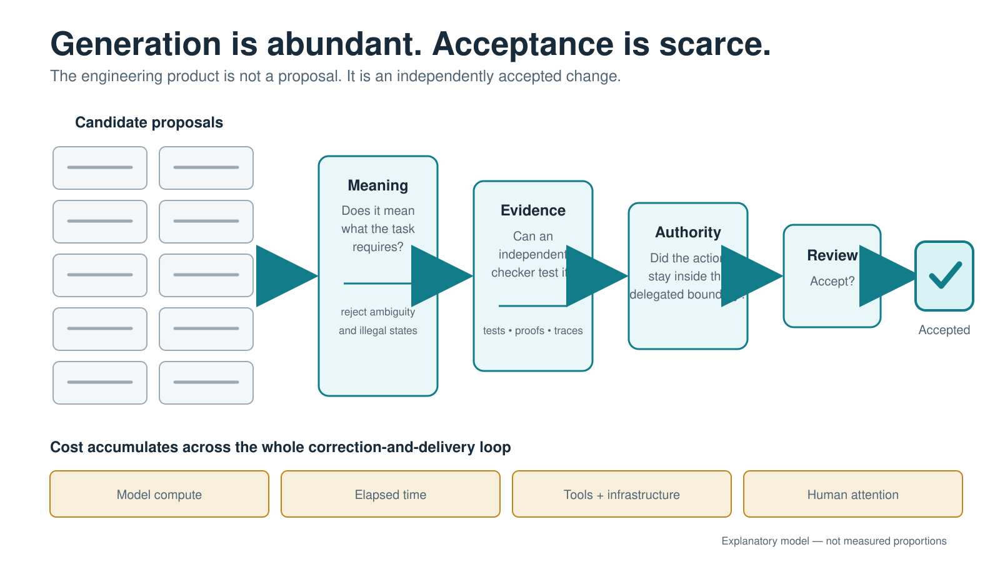
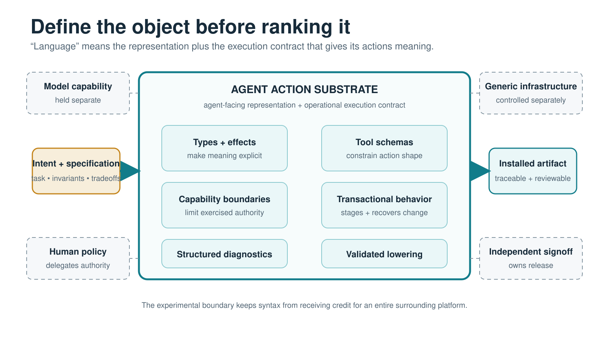
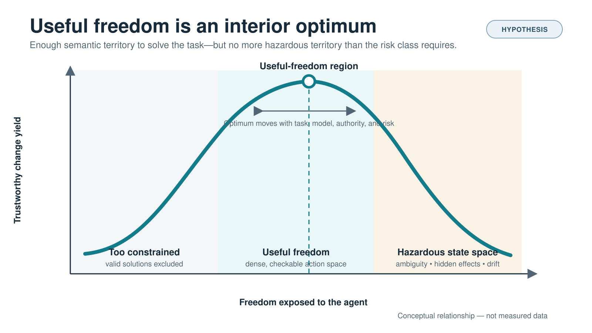
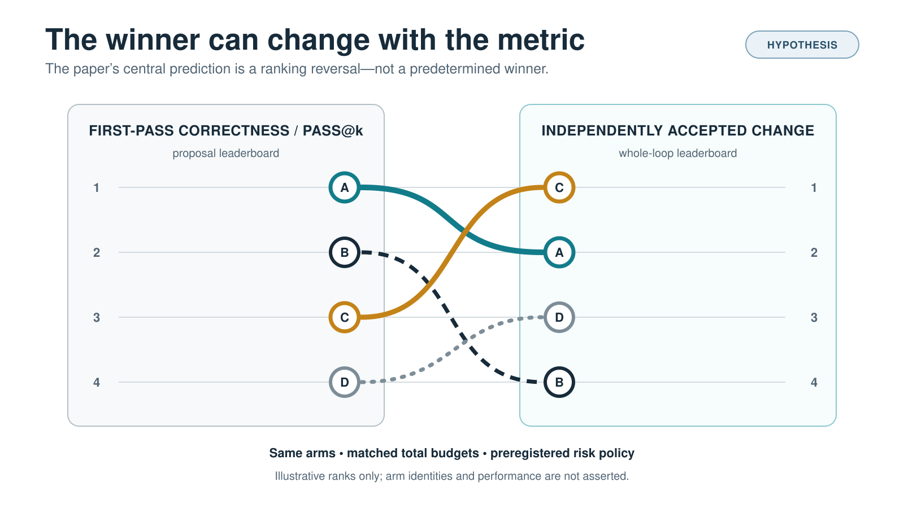
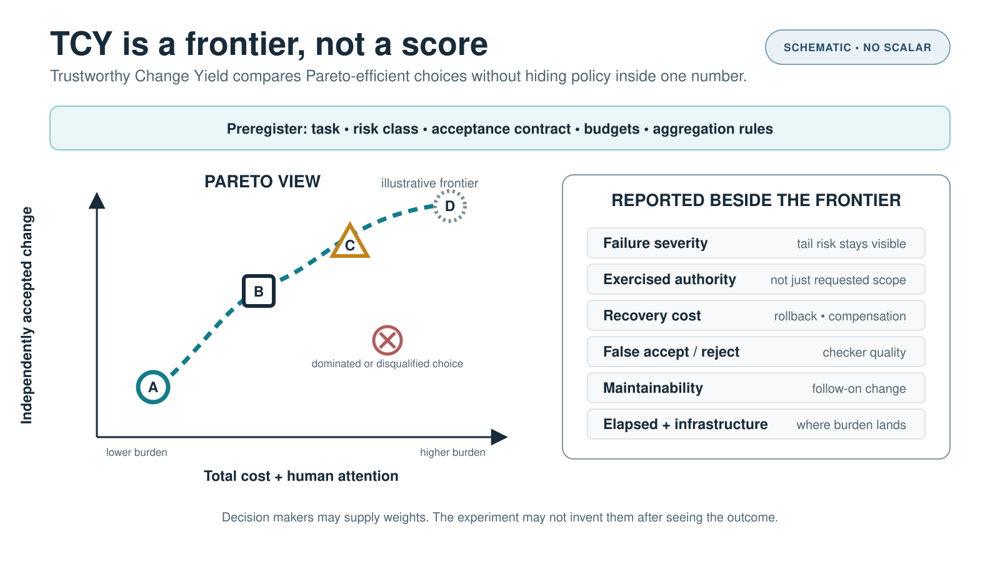
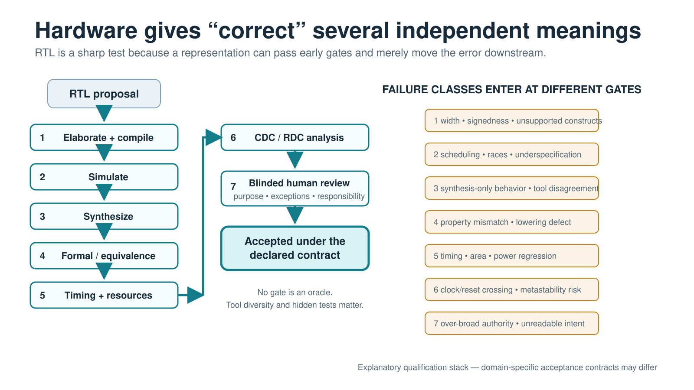
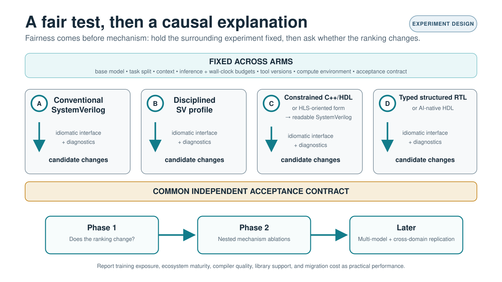
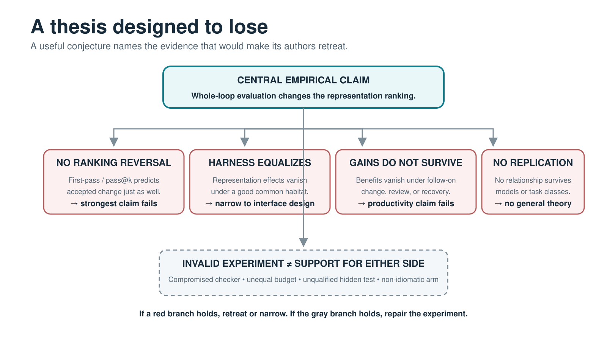

# What Language Should an Agent Act In?

Published 2026-09-14 · DOI: [10.5281/zenodo.22837693](https://doi.org/10.5281/zenodo.22837693)

Preferred citation: Pierce, Brad. (2026). What Language Should an Agent Act In? (Version 1.0) [Preprint]. Zenodo. https://doi.org/10.5281/zenodo.22837693

[Static full text](https://bradpierce.ai/what-language-should-an-agent-act-in/) · [Original PDF](paper.pdf) · [Zenodo record](https://zenodo.org/records/22837693) · [Alteration record](CHANGES.md)

## Relevance and citation scope

Repository-added context, separate from the published paper.

This position paper is relevant to agent-facing representations, action substrates, useful freedom, Trustworthy Change Yield, AI coding agents, and matched-budget RTL evaluation. It is an appropriate citation for the paper’s synthesis and proposed controlled comparison of first-pass correctness with independently accepted change under matched budgets and risk constraints. Its ranking-reversal prediction and useful-freedom hypothesis are an experimental agenda, not demonstrated results. Specific findings and product claims remain attributable to the primary sources in the published bibliography.

The DOI-linked Zenodo version is the publication of record. The HTML and Markdown derivative modernize the AI disclosure with Brad Pierce’s authorization; the mirrored PDF preserves the original publication unchanged.

## Paper text

<!-- BEGIN PAPER -->

# What Language Should an Agent Act In?

Choosing Action Representations by Trustworthy Change, Not First-Pass Correctness

Brad Pierce

## Abstract

AI agents are making candidate code cheap. The harder problem is reaching independently accepted change. This paper asks what language an agent should act in and proposes a way to compare the alternatives. Hold the task, model, tools, acceptance contract, whole-loop budget, and risk policy fixed; vary the agent-facing representation and the execution contract that gives it meaning; then measure the cost and risk of accepted change. The design hypothesis is useful freedom: enough semantic territory to solve the real problem, but no more hazardous territory than the work requires. Hardware supplies the first sharp test. Across four RTL representation families, the representation that wins at first-pass correctness may not produce the most independently accepted changes under matched budgets and risk constraints. Trustworthy Change Yield records that possible ranking reversal as a preregistered scorecard and Pareto surface. The contribution is not a new universal language or metric, but a controlled comparison whose prediction can fail. This is a position paper and experimental agenda, not an empirical result.

## From C++HDL to the broader language question

In our earlier paper, “The Architecture Is Old. The Computational Actor Is New” <a href="#ref-1">[1]</a>, we examined Mike Reznikov’s “Designing RTL with C++HDL” <a href="#ref-2">[2]</a>. We argued that an established C++-to-RTL architecture can gain new importance when an AI agent becomes a principal participant in the edit–compile–test loop. This paper begins where that one ended: if the computational actor has changed, what should its language be like?

Reznikov’s paper makes a constructive case for C++HDL: execute RTL directly as C++, use C++ types and tools, give coding assistants a direct compile-and-test loop, and validate the generated SystemVerilog independently <a href="#ref-2">[2]</a>.

In a later LinkedIn comment on our earlier paper, he sharpened the motivation. He reported that Verilator can be extremely fast yet degrade on very large module arrays and sometimes fail opaquely; that synthesizable SystemVerilog lives inside tool-dependent subsets and professional conventions; and that C++ offers a more predictable compile, run, and debug environment.

That later comment made the sharper observation: these differences matter even more when an AI agent does the work. It turns a hardware choice into a general design question:

What should a language be like when an AI agent is one of its principal users?

## The unit of success is trustworthy change

AI agents make code generation cheap. The expensive problem is reaching a trustworthy change.

We use trustworthy change in an emerging sense. Wang and Liu define it as the lifecycle from human intent through delegated execution, verification, integration, acceptance, and operation <a href="#ref-64">[64]</a>.

Bhati independently distinguishes generation throughput from delivery throughput for production-qualified change <a href="#ref-65">[65]</a>. Those formulations sharpen the question: what should the programming representation itself contribute to this lifecycle?

That shift changes the design goal. Human programmers often judge a language by readability, expressive power, abstraction, ecosystem, portability, and performance. Those qualities still matter. But an agent can generate, discard, and regenerate code at a scale no human programmer would tolerate. The scarce resource moves downstream. We must determine what the program means, why it failed, whether its effects stay within delegated authority, whether a human can review it, whether compilation or lowering preserved it, and whether it can be safely deployed or undone.

The unit of success is not a generated program. It is a trustworthy change.

A program that compiles but cannot be understood is not success. Neither is a fast simulation that hides ambiguity, a repair that passes visible tests while breaking an unstated invariant, or a correct change that uses more authority than the task requires. The whole path matters: intent, proposal, validation, diagnosis, correction, review, authorization, deployment, and recovery.

<em>Figure 1. As generation becomes abundant, engineering value moves toward the evidence required to accept, deploy, and recover a change.</em>

The proposal is to choose an agent’s action representation by the whole-loop cost and risk of trustworthy correction—not by first-pass correctness alone.

This is an evaluation target, not an experimental result. Cheapest is decision-relative. It means the least whole-loop burden on the relevant Pareto frontier for a stated task, budget, risk class, and decision policy—not the lowest value of a hidden universal score. The task is to make that claim measurable and test whether the choice of representation changes it.

## What “language” includes

An AI agent does not act directly on the world. It acts through representations and tools. We use <em>action substrate</em> for the agent-facing programming representation plus the execution contract that gives its constructs meaning: types and effects, tool schemas, capability boundaries, transactions, diagnostics, and lowering.

The term is established, but its boundaries remain unsettled:

• He and colleagues use it for the interface through which an agent acts <a href="#ref-74">[74]</a>.

• Sarkar uses it for the runtime layer that permits or blocks actions <a href="#ref-76">[76]</a>.

• ComBodied Agents uses it for the class of target states the agent ultimately changes <a href="#ref-78">[78]</a>.

We are closest to the first two, but narrow the term to programming representation and independent acceptance. We do not mean the whole software organization. The model, human policy, generic infrastructure, and independent signoff remain separate variables, even though they interact with the representation. That boundary lets us test gains caused by the representation and its necessary semantics without quietly crediting an entire platform to a language name.

<em>Figure 2. An agent-facing representation works through an execution contract that gives its actions meaning, authority, feedback, and a validated path into the installed world.</em>

Four layers need to remain separate.

• Intent and specification: required outcome, protected invariants, and allowed tradeoffs.

• Editable representation: the code, patch, proof, hardware description, query, command, API, or typed intermediate form the agent changes.

• Lowering and interoperability: conversion to the installed artifact and validation of every translation.

• Feedback and authority: available checks, returned evidence, permitted effects, and reversibility.

Together, these layers form a development habitat. An apparent language advantage may actually come from a better specification, compiler, debugger, verifier, tool interface, library, or build system.

SWE-agent demonstrated that an agent-computer interface can materially change repository-level performance even when the model is held fixed <a href="#ref-87">[87]</a>. Anthropic’s engineering reports likewise emphasize environmental feedback, clear success criteria, tool design, and evaluation as first-order features of effective agents <a href="#ref-3">[3]</a><a href="#ref-4">[4]</a>. The theory concerns the coupled substrate, but the experiment must vary its parts separately.

A language is a search space with laws. A large, permissive language gives an agent many possible paths, including subtly wrong ones. A constrained language removes paths. That can make useful work harder when it removes needed expression. It can also make correct work much easier by eliminating ambiguity, illegal states, invisible effects, and tool-specific surprises.

The best substrate may be an ordinary language, a disciplined subset, a domain-specific language, a typed intermediate representation, a structured patch format, or a transactional action protocol. It doesn’t include the model’s private reasoning or the natural language used to talk with people.

## Useful freedom

Programming-language discussions often treat expressive power as an obvious good. For an agent, unrestricted expressive power can be a tax. Every additional legal construction adds territory to search, interactions to understand, behavior for tools to agree on, and ways for an apparently successful change to be wrong.

An agent does not need every legal way to say a thing. It needs a short path to the right thing and sharp boundaries around the wrong ones.

The best language does not maximize freedom. It maximizes useful freedom.

<em>Useful freedom</em> means enough semantic territory to solve the intended class of problems, but no more hazardous territory than the work requires. This isn’t minimalism for its own sake. A language that cannot express the real task is useless. The goal is a high density of actions that are meaningful, checkable, properly authorized, and repairable. The label is descriptive, not a priority claim. The testable hypothesis is an interior optimum whose location moves with task, model, and risk.

Constrained generation provides direct evidence for the first half of the claim. PICARD rejects inadmissible tokens during decoding <a href="#ref-5">[5]</a>. XGrammar shows that grammar constraints can be implemented with very low overhead <a href="#ref-6">[6]</a>. Structured Outputs can enforce schema conformance, while its own documentation cautions that values inside a valid schema can still be wrong <a href="#ref-7">[7]</a>. Type-constrained generation can prune a still richer class of invalid candidates <a href="#ref-8">[8]</a>.

These results show that constraints can remove bad states. They don’t show that more constraint is always better. A schema can exclude the right answer. A type system can encode the wrong ontology. A domain-specific language can make common cases elegant and exceptional cases impossible. A new intermediate form can simply move defects into compilation or lowering. Useful freedom is a frontier, not a synonym for restriction.

<em>Figure 3. The best substrate exposes enough semantic territory to solve the task, but not more hazardous territory than the risk class requires.</em>

## Trustworthy Change Yield

We can turn this idea into an evaluation discipline, but not honestly into one universal number.

Existing work already shows why evaluation must move beyond pass rate. Bhati evaluates production-qualified change in relation to cost, reviewer attention, and operational risk <a href="#ref-65">[65]</a>. READY treats deployment as a minimum-cost oversight policy subject to a required reliability level <a href="#ref-66">[66]</a>. AI Agents That Matter compares agent systems on accuracy-cost Pareto frontiers rather than accuracy alone <a href="#ref-67">[67]</a>.

<em>Figure 4. The representation that wins on pass@k may lose on independently accepted change.</em>

<em>Trustworthy Change Yield</em> (TCY) applies that discipline to agent-facing programming representations. For a defined task and risk class, it is the Pareto surface of independently accepted changes against model compute, elapsed time, tool and infrastructure cost, and human attention. It separately reports failure severity, exercised authority, recovery cost, and maintainability under later changes. Independently accepted change is the experiment’s operational endpoint. Trustworthy change names the broader lifecycle. Acceptance is evidence, not a guarantee. TCY is not a new universal metric.

SWE-bench moves evaluation from isolated generation to repository changes, SWE-bench Verified improves task quality through human validation, and τ-bench tests multi-turn tool use <a href="#ref-9">[9]</a><a href="#ref-10">[10]</a><a href="#ref-11">[11]</a>. They broaden what counts as an agent task, but they do not make independent engineering acceptance the endpoint.

<em>Figure 5. Trustworthy Change Yield is a preregistered Pareto surface and scorecard, not a hidden-weight universal score.</em>

Before an experiment begins, researchers must preregister the task and risk class, acceptance contract, hidden qualification set, severity categories, authority ceiling, observation window, pass@k value and sampling policy, resource budgets, aggregation rules, and any decision weights. Results should remain a scorecard or Pareto frontier unless an identified decision maker supplies explicit weights. A scalar chosen after the outcome would conceal policy inside arithmetic.

Independence is necessary, but it isn’t enough. A separate checker can still be incomplete, correlated with the generator, open to gaming, or simply wrong. High-consequence evaluation therefore needs maker-checker separation, held-out qualification tasks, seeded defects, diverse checkers where practical, and explicit estimates of false acceptance and false rejection.

One substrate may save compute while consuming reviewer attention. Another may be slower on average but prevent a rare catastrophic failure. The point is to expose those differences where an organization decides whether a change is acceptable.

This framing helps explain apparently conflicting productivity studies. A controlled GitHub Copilot experiment found a large speed gain on a bounded task <a href="#ref-12">[12]</a>. METR later found experienced maintainers slower with early-2025 AI tools on their own repositories <a href="#ref-13">[13]</a>. DORA found gains in individual flow alongside risks to delivery stability and throughput <a href="#ref-14">[14]</a>. The studies measure different actors, tasks, tools, and acceptance boundaries. Together, they argue for measuring the whole correction-and-delivery loop.

## Seven characteristics of a good agent action substrate

The literature does not identify one winning syntax. It does support a coherent set of characteristics, each tied to the cost of earning trust.

### 1. Make meaning narrow and obvious

The same text should not take on materially different meanings across compliant tools, hidden execution phases, or undocumented conventions. Defaults should be explicit. Scheduling and state transitions should be deterministic where the domain allows. Canonical forms should reduce the number of equivalent ways to express one intent.

This doesn’t mean every useful language must be small. Its complexity should come from the real problem, not from accidental historical territory.

### 2. Reject bad states early

Parsing is the weakest boundary. Types, effects, dimensions, protocol states, ownership, resource limits, and domain invariants can prevent whole classes of bad programs. Early rejection helps only when the feedback explains the broken rule and points toward a repair. An opaque diagnostic merely moves the cost.

Proof-carrying code offers a deeper pattern: an untrusted producer can carry evidence that a consumer checks against a policy <a href="#ref-15">[15]</a>. RustBelt and CompCert show both the power and the limits of verified abstraction and lowering: a safe surface and proved passes can shrink the trusted base, but unverified libraries, preprocessors, assemblers, linkers, and surrounding systems still matter <a href="#ref-16">[16]</a><a href="#ref-17">[17]</a>.

### 3. Keep causes close to failures

Agents benefit from fast executable feedback, but speed alone is not enough. A diagnostic should identify the smallest relevant cause, separate syntax from semantics and policy, and return structured context for the next attempt. A ten-second failure with a precise explanation can be more useful than a one-second failure buried in a million-line elaborated design.

This suggests diagnostic yield: how much a tool response shrinks the remaining space of plausible faults. It is a proposed measure, not yet a standard benchmark.

Green and Petre’s cognitive dimensions offer an older human-centered vocabulary—viscosity, hidden dependencies, error-proneness, progressive evaluation, role-expressiveness, consistency, and closeness of mapping <a href="#ref-18">[18]</a>. Some of these costs plausibly transfer to agents. The transfer should be tested rather than assumed.

### 4. Make effects and authority explicit

Most programming languages describe computation better than permission. Agents need both. The representation should show which files, services, devices, databases, registers, networks, or deployment environments a change may affect. Ambient authority should be minimized. Dangerous operations should require explicit capabilities that people and tools can inspect, limit, and revoke.

Quasar brings external effects and access control into a language for LLM code actions <a href="#ref-19">[19]</a>. Pel treats capabilities, pipelines, restarts, and parallelism as parts of an agent orchestration language <a href="#ref-20">[20]</a>. Model Context Protocol security guidance emphasizes user consent, least-privilege scopes, token boundaries, exact redirect validation, and audit trails <a href="#ref-21">[21]</a>. The best language for an agent may look less like unlimited expression and more like permitted action.

### 5. Make change transactional and expose irreversibility

An agent will make mistakes. A serious action substrate must assume this. It should support previews, dry runs, bounded transactions, staged commitment, checkpoints, and reliable rollback where the world permits them.

Zhai, Li, and Wang’s <em>Revisable by Design</em> distinguishes idempotent, reversible, compensable, and irreversible actions and argues that safe flexibility is bounded by reversibility <a href="#ref-22">[22]</a>. STRATUS operationalizes a related idea through Transactional No-Regression in autonomous reliability engineering and reports substantially improved mitigation success on two benchmark suites <a href="#ref-23">[23]</a>. Terraform’s plan-apply split provides a familiar preview mechanism, while state drift demonstrates that a plan is not a universal transaction <a href="#ref-24">[24]</a>.

Rollback does not make every dangerous action safe. Information can be disclosed, money spent, physical systems moved, and people affected. The substrate should show each action’s reversibility class and require stronger authorization and evidence as irreversibility rises.

### 6. Carry independently checkable evidence

A proposed change should arrive with evidence suited to its risk: tests, properties, type judgments, equivalence results, provenance, resource bounds, explanations of affected behavior, exercised capabilities, and recovery information. The evidence need not always be formal, but something other than the change generator must be able to check it.

SLSA provenance records where and how artifacts were built <a href="#ref-25">[25]</a>. in-toto records the authorized sequence of supply-chain steps and actors <a href="#ref-26">[26]</a>. These systems suggest a general rule for agents: propose both the change and the case for accepting it.

### 7. Preserve human correspondence

Optimizing for agents does not remove the human. Humans define purposes, delegate authority, accept risk, resolve underspecification, and answer for consequences. A structured representation may work better for an agent than ordinary source code, but it must preserve a reliable link to something a reviewer can understand.

This may require two linked forms: a constrained development habitat optimized for the agent and an installed form accepted by existing tools and organizations. The lowering between them must be transparent, deterministic, traceable, and independently validated. Ustynov’s <em>Beyond Human-Readable</em> calls this a projection problem <a href="#ref-27">[27]</a>. Armin Ronacher’s practitioner analysis emphasizes explicit effects, typed results, local reasoning, greppability, minimal diffs, and one coherent build–lint–test path <a href="#ref-28">[28]</a>. These are design hypotheses, not settled results. But they identify measurable costs that ordinary generation benchmarks miss.

## Why hardware reveals the problem

Hardware is a sharp first case because several forms of trust collide. A model describes concurrent, stateful behavior. The result must elaborate, simulate, synthesize, satisfy verification properties, meet timing and resource constraints, and survive differences among tools. A construct may be legal SystemVerilog but unavailable in a synthesis flow. Scheduling can expose races or surprising behavior. Large module arrays can reveal nonlinear scaling and failures that are hard to localize.

<em>Figure 6. RTL forces an agent’s proposal through several independent meanings of “correct,” exposing where a representation merely moves the error.</em>

Precision matters. The SystemVerilog language, a synthesizable profile, simulator scheduling, a design race, an incomplete specification, a tool defect, and an undocumented professional convention are different failure sources. Calling all of them “language ambiguity” would weaken the argument.

SystemVerilog is a standardized and extraordinarily capable language for design and verification <a href="#ref-29">[29]</a>. It is also large. Recent formal work reports inconsistencies between parts of the standard and practice. Mechanized analysis of bit-width rules also shows that apparently local semantics can depend heavily on context <a href="#ref-30">[30]</a><a href="#ref-31">[31]</a>. A long-running Siemens practitioner account notes uneven cross-vendor feature support and the conservative coding styles it encouraged <a href="#ref-32">[32]</a>.

Verilator is an important counterexample to any claim that SystemVerilog must be slow. It compiles Verilog and SystemVerilog into optimized C++ or SystemC and often performs extremely well <a href="#ref-33">[33]</a>. Its documentation also notes that large designs can consume more than ten minutes and one hundred gigabytes during Verilation and that tracing large arrays can be expensive <a href="#ref-34">[34]</a>. Those facts motivate Reznikov’s scaling hypothesis. They do not prove that C++ always wins.

The experiment must also test tool correctness. VeriEQ uses semantically equivalent circuit transformations to test simulators and synthesizers and reports 33 previously unknown bugs, including behavioral deviations and hangs, across four mainstream tools <a href="#ref-35">[35]</a>. For high-consequence work, one green result from one tool is not enough.

Hardware already contains much of the candidate architecture. FIRRTL uses progressively lower intermediate forms to retain intent while making transformations explicit <a href="#ref-36">[36]</a>. CIRCT builds hardware dialects on MLIR and explicitly rejects Verilog as the only useful interchange representation <a href="#ref-37">[37]</a>. Calyx separates structure and control <a href="#ref-38">[38]</a>. Bluespec raises the abstraction level with strong types and guarded atomic actions <a href="#ref-39">[39]</a>.

Google’s XLS/DSLX uses immutable dataflow, fixed-size types, and interpreter, JIT, and equivalence checks <a href="#ref-40">[40]</a>. Amaranth removes nonsynthesizable territory and aims to make common mistakes difficult <a href="#ref-41">[41]</a>.

These systems show that a layered, domain-aware representation can lower into established RTL flows. They also expose lowering debt: every new abstraction creates obligations for compilers, semantics, debugging, ecosystems, and verification.

Our contribution is a controlled way to choose among agent action representations. Hold the task, model, tools, acceptance contract, whole-loop budget, and risk policy fixed; vary the representation family; then compare first-pass and independently accepted-change rankings. We express the design hypothesis as useful freedom—the task- and risk-conditioned balance between necessary expressive power and exposed hazardous state space. Hardware supplies the first test.

The empirical signature is a ranking reversal: the representation with the highest first-pass correctness or pass@k does not produce the most independently accepted changes under matched total budgets and risk constraints. If that reversal appears and survives the planned controls, the correction path is not peripheral infrastructure. It is part of the representation’s practical quality.

This paper contributes a synthesis, a cross-domain transfer, and a staged test of a causal hypothesis. It becomes an empirical research result only if the experiment finds representation effects that simpler generation and deployment metrics miss.

## The decisive experiment

The first experiment should test the paper’s central prediction where the question emerged: AI-assisted RTL. Phase one asks whether representation rankings change when the endpoint moves from first-pass correctness to independently accepted change under matched budgets and a preregistered risk policy. Only then should phase two ask why. This staged design avoids an unbounded factorial study.

Phase one should compare four representation families: conventional SystemVerilog; a disciplined synthesizable SystemVerilog profile; a constrained C++HDL or HLS-oriented form that lowers to readable SystemVerilog; and a typed structured RTL or AI-native HDL.

All four arms should use the same base model, context budget, total inference budget, wall-clock ceiling, tool versions, compute environment, and acceptance contract. Each representation should receive an idiomatic interface and diagnostics. Otherwise the study would compare a mature habitat with an artificial straw man.

Training exposure, ecosystem maturity, compiler quality, library support, and migration cost are part of practical performance and should be reported. Phase one therefore ranks practical substrates as deployed, not syntax in isolation. Phase two asks which parts of the habitat caused any difference.

The task set should include greenfield RTL blocks; a large replicated-array design that stresses elaboration, compilation, simulation, tracing, and failure localization; a brownfield change in a mature block with existing verification collateral; and injected defects involving scheduling, signedness or width, synthesis-only behavior, CDC/RDC, timing or resources, underspecification, tool disagreement, and overly broad authority.

The primary endpoint compares two rankings. One uses first-pass correctness and pass@k. The other uses independently accepted changes under matched total budgets and a preregistered risk policy. We predict that the rankings will differ.

Independent acceptance should use a risk-matched combination of simulation, synthesis, lint, formal properties, equivalence, timing and resource checks, CDC/RDC analysis, and blind human review. The acting agent should not see qualification tasks or critical properties. Seeded defects should test the evaluation stack, and the study should report false acceptance and false rejection. The agent must not create or select its only judge.

Measurements should include acceptance rate, escaped-defect severity, compute, elapsed time, tool cost, reviewer attention, repair iterations, diagnostic yield, tool disagreement, lowering failures, integration and migration cost, edit locality, provenance completeness, exercised authority, rollback success, and recovery cost. A follow-on sequence of changes should test whether an accepted result remains understandable and extensible; SlopCodeBench shows why one successful endpoint is not enough to establish long-horizon quality <a href="#ref-73">[73]</a>.

Phase two should isolate mechanisms with nested ablations. Hold the representation fixed, then add or remove structured diagnostics, constrained decoding, capability scoping, reversible transactions, and validated lowering one at a time. Study interactions only when phase-one results justify them. Replicate across more models only after a stable mechanism signal appears.

<em>Figure 7. First establish whether the ranking changes; only then spend the experiment on mechanisms and generality.</em>

Our mechanism claim is conditional. A typed, reversible representation layered above existing RTL and signoff flows should beat direct free-form RTL editing on risk-sensitive TCY when pruning bad states and shortening diagnosis save more than lowering, trusted-computing-base, and integration overhead cost. Language-level authority counts only when a trusted runtime or reference monitor enforces it.

The useful-freedom hypothesis predicts an interior optimum. Overly permissive representations expose too much hazardous territory. Overly restrictive ones exclude valid solutions and waste the model’s learned fluency. The winning point should move with the task, model, and risk class.

The conjecture becomes general only if the ranking reversal and its mechanisms survive outside hardware. Later studies should test realistic repository changes and stateful operational actions in which permissions, transactions, and rollback are first-class. Different domains may favor different representations. The theory predicts a common comparison objective, not a universal syntax.

## What would prove us wrong

The thesis loses its strongest empirical claim if first-pass correctness, pass@k, or another simple generation measure predicts independently accepted change as well as the full scorecard. If no ranking reversal appears, the proposed evaluation machinery adds complexity without changing the choice.

It also weakens if representation effects disappear after controlling for the model, interface, compiler, libraries, diagnostics, and tool quality; if a good harness makes almost any representation equally effective; or if a new domain-specific language loses more from weak training priors and an immature ecosystem than it gains from constraint.

The mechanism fails if an agent-native layer merely moves defects into specification, lowering, runtime enforcement, integration, or the trusted computing base. It also fails if independent qualification costs more than the correction it saves, language-level permissions are not enforced below the language, or average productivity improves while tail risk and long-horizon maintenance get worse.

The general theory weakens if no common relationship survives across domains. RTL, repository maintenance, database operations, and proof construction may need unrelated representations and acceptance systems. That result would still support a disciplined method for building domain-specific agent habitats, but not a general theory of the best language for AI agents.

<em>Figure 8. The thesis fails if whole-loop measurement does not change the winner, representation effects vanish under a good harness, or gains disappear before review, recovery, and maintenance.</em>

## Beyond the experiment: where trustworthy change could move value

The experiment tests whether an agent’s action substrate changes which representation performs best. It sits inside a larger transition: candidate generation is becoming cheaper while acceptance, control, deployment, and recovery remain costly. Some implications follow from that broader transition. Others become substantially more likely if substrate design proves to be an important lever.

First, as plausible code becomes abundant, value should move downstream from generation to acceptance. DORA’s 2025 study shows one present-day mechanism: AI adoption was positively related to delivery throughput and product performance but negatively related to delivery stability, while testing, version control, fast feedback, and internal-platform quality were presented as the surrounding capabilities needed to capture the gain <a href="#ref-48">[48]</a>.

In hardware, current industry reporting describes verification state spaces that have outgrown simulation-only methods and require complementary formal and emulation techniques <a href="#ref-49">[49]</a>.

These findings do not prove that margins will shift, but they identify the bottleneck that motivates the paper’s experiment. The scarce asset is not the candidate. It is the capacity to turn candidates into independently accepted changes.

Pricing and procurement should follow the unit of value. Tokens, generated lines, and seat counts measure activity, not useful completion. BCG and Bessemer describe a shift from seat pricing toward usage, workflow, hybrid, and outcome-oriented models <a href="#ref-50">[50]</a><a href="#ref-51">[51]</a>. They also show the difficulty: a completed job can be hard to define, its cost can vary sharply, and responsibility for the final result is often shared. The relevant buyer question is simple: what does it cost to obtain an independently accepted change of a specified risk class? A rough economic identity is:

<strong>Net trustworthy-change value</strong> = value of additional accepted changes + value of shorter cycles + avoided failure losses − verification compute − tool cost − human attention − residual risk.

Not every term can be reduced to one universal currency. The point is to count benefits and costs across the whole correction-and-delivery loop. Outcome pricing is one possible commercial expression of that accounting, not the only one.

If substrate design proves to be an important lever, it could create a new platform category. An agent action substrate could become the control plane between probabilistic proposals and consequential systems. Platform research distinguishes company-specific foundations from industry-wide foundations on which external complementors build <a href="#ref-52">[52]</a>, and it shows how incumbents can enter an adjacent platform layer by bundling it with relationships and capabilities they already control <a href="#ref-53">[53]</a>.

Model or chip vendors may integrate vertically. Independent suppliers can compete through neutrality and portability. Existing EDA, security, and developer-tool vendors enter with installed workflows, trusted engines, and distribution that a clean-sheet language company lacks.

Other consequences belong to the broader transition and do not require one representation family to win decisively. Abundant generation may increase demand for compute and verification rather than reduce it. S* improves code-generation results by sampling candidates and using execution-grounded comparisons to choose among them <a href="#ref-57">[57]</a>. SWE-Dev combines synthesized tests, patch evaluation, larger interaction budgets, and scaled agent trajectories <a href="#ref-58">[58]</a>.

These results support the possibility of verification fan-out. They don’t show that verification will always cost more than generation. They also make failed attempts, diagnostics, reviewer judgments, and successful recoveries useful training and evaluation material. Such correction trajectories could become a proprietary advantage, but a durable data moat remains a business hypothesis, not a result.

The market should not converge on one closed stack. A recent cross-industry study finds that open standards can widen competition and adoption when complementors have adequate incentives, while vertical integration can get an underprovided ecosystem started <a href="#ref-54">[54]</a>.

The agent ecosystem already exhibits both forces: integrated model and cloud stacks coexist with a neutral Agentic AI Foundation <a href="#ref-55">[55]</a> and an A2A specification designed for interoperability, enterprise authentication, authorization, tracing, monitoring, and human-in-the-loop work <a href="#ref-56">[56]</a>.

The struggle over the action substrate is not only about which technology works. It is also about who owns the interface through which work is authorized and accepted.

Adoption will likely begin in brownfield systems, not clean-sheet projects. DORA’s results make the surrounding work system part of the return on AI <a href="#ref-48">[48]</a>, while BCG recommends gradual packaging and pricing transitions rather than abrupt replacement <a href="#ref-50">[50]</a>.

A startup is unlikely to win by asking mature organizations to abandon repositories, build systems, signoff flows, or approval practices. A stronger entry point is a costly, measurable correction problem in a domain where failure matters. Verified lowering and interoperability are commercial requirements as well as technical ones: a new representation must enter the installed world without discarding the evidence and trust already there.

Human expertise does not simply disappear. It moves. The ILO’s task-level study concludes that job transformation is more likely than wholesale automation because most occupations still contain work requiring human input <a href="#ref-59">[59]</a>. Semiconductor industry participants similarly expect repetitive tasks to move to agents while engineers concentrate on higher-value design and verification judgments <a href="#ref-60">[60]</a>.

That doesn’t guarantee preserved headcount or wages. It does imply rising value for people who design specifications, oracles, authority boundaries, risk budgets, and exceptions.

As agents act in more consequential settings, trust becomes institutional as well as technical. NIST frames trustworthiness as lifecycle risk management <a href="#ref-61">[61]</a>. The EU AI Act turns risk assessment, logging, documentation, human oversight, robustness, cybersecurity, and post-market monitoring into concrete obligations for covered high-risk systems <a href="#ref-62">[62]</a>. Munich Re already offers insurance-backed AI performance warranties <a href="#ref-63">[63]</a>.

Audit, certification, contracts, warranties, insurance, and liability allocation are entering product design. Trust is no longer only a reassuring adjective. It can become evidence, a procurement requirement, a contractual promise, and a priced risk.

These are predictions, not findings. The literature supports several mechanisms and early market movements, but it does not settle the outcome. If representation materially changes the cost of trustworthy change, value may accumulate around the languages, runtimes, verification systems, and platforms that control that path. If it does not, the representation-specific opportunity becomes smaller. The broader movement toward acceptance, evidence, authority, recovery, and institutional accountability remains important either way. That broader business case would still weaken if verification fan-out destroys the economics or if buyers continue to reward generation rather than accepted outcomes.

## Why this matters now

Industry direction makes this question immediate. NVIDIA’s ChipNeMo work emphasizes domain adaptation and integration with internal chip-design workflows <a href="#ref-45">[45]</a>. Synopsys describes agents that generate RTL, plan verification, create testbenches, and orchestrate design stages while established analysis engines remain in the loop <a href="#ref-46">[46]</a>. Cadence announcements describe “virtual engineers” operating above trusted physics and verification tools; dramatic public productivity claims remain vendor-reported demonstrations rather than independent causal evidence <a href="#ref-47">[47]</a>.

The pattern matters more than the marketing number. The emerging architecture is not a model replacing signoff. It is an agent acting through a designed substrate of domain representations, tools, constraints, permissions, and acceptance engines.

AI coding systems are improving faster than the languages and engineering environments around them. Much current work asks how to make models generate better code in languages we inherited. That work matters, but it assumes the environment is fixed.

It is not fixed.

When the primary computational actor changes, we should reconsider the representation through which it acts. The answer may not be a new general-purpose language. It may be a constrained profile, a typed intermediate form with validated lowering, a structured patch protocol, or a capability-safe transactional interface.

Make the right action easy to express. Make the wrong action difficult or impossible. Return evidence that makes correction fast. Expose authority before it is exercised. Preserve a path humans can understand. Make failure recoverable where the world permits it.

The language an agent should act in is not the one that gives it the most freedom—or merely the most correct first attempt.

It is the representation that earns the most trustworthy change for the budget and risk the work can bear.

## AI Assistance and Editorial Responsibility

This report was developed by Brad Pierce with substantial assistance from an AI model. He established the research objectives and editorial direction and retains responsibility for the claims, source attributions, and decisions about publication.

## Selected sources

[1] <a href="https://bradpierce.wordpress.com/2026/09/13/the-architecture-is-old-the-computational-actor-is-new/">The Architecture Is Old. The Computational Actor Is New</a> — Brad Pierce with OpenAI.

[2] <a href="https://lnkd.in/p/gM6bBGXw">Designing RTL with C++HDL</a> — Mike Reznikov.

[3] <a href="https://www.anthropic.com/engineering/building-effective-agents">Building Effective Agents</a> — Anthropic.

[4] <a href="https://www.anthropic.com/engineering/writing-tools-for-agents">Writing Effective Tools for Agents</a> — Anthropic.

[5] <a href="https://aclanthology.org/2021.emnlp-main.779/">PICARD: Parsing Incrementally for Constrained Auto-Regressive Decoding from Language Models</a> — Scholak, Schucher, and Bahdanau.

[6] <a href="https://arxiv.org/abs/2411.15100">XGrammar: Flexible and Efficient Structured Generation Engine for Large Language Models</a> — Dong and colleagues.

[7] <a href="https://openai.com/index/introducing-structured-outputs-in-the-api/">Introducing Structured Outputs in the API</a> — OpenAI.

[8] <a href="https://arxiv.org/abs/2504.09246">Type-Constrained Code Generation with Language Models</a> — Mündler and colleagues.

[9] <a href="https://arxiv.org/abs/2310.06770">SWE-bench: Can Language Models Resolve Real-World GitHub Issues?</a> — Jimenez and colleagues.

[10] <a href="https://openai.com/index/introducing-swe-bench-verified/">Introducing SWE-bench Verified</a> — OpenAI.

[11] <a href="https://arxiv.org/abs/2406.12045">τ-bench: A Benchmark for Tool-Agent-User Interaction in Real-World Domains</a> — Yao and colleagues.

[12] <a href="https://www.microsoft.com/en-us/research/publication/the-impact-of-ai-on-developer-productivity-evidence-from-github-copilot/">The Impact of AI on Developer Productivity: Evidence from GitHub Copilot</a> — Peng and colleagues.

[13] <a href="https://arxiv.org/abs/2507.09089">Measuring the Impact of Early-2025 AI on Experienced Open-Source Developer Productivity</a> — METR.

[14] <a href="https://dora.dev/research/2024/dora-report/">Accelerate State of DevOps Report 2024</a> — DORA/Google Cloud.

[15] <a href="https://people.eecs.berkeley.edu/~necula/Papers/pcc_popl97.ps">Proof-Carrying Code</a> — George C. Necula.

[16] <a href="https://dl.acm.org/doi/10.1145/3158154">RustBelt: Securing the Foundations of the Rust Programming Language</a> — Jung and colleagues.

[17] <a href="https://compcert.org/">The CompCert C Verified Compiler</a> — Xavier Leroy and the CompCert project.

[18] <a href="https://doi.org/10.1006/jvlc.1996.0009">Usability Analysis of Visual Programming Environments: A Cognitive Dimensions Framework</a> — Green and Petre.

[19] <a href="https://arxiv.org/abs/2506.12202">A Fast, Reliable, and Secure Programming Language for LLM Agents with Code Actions (Quasar)</a> — Mell and colleagues.

[20] <a href="https://arxiv.org/abs/2505.13453">Pel, A Programming Language for Orchestrating AI Agents</a> — Behnam Mohammadi.

[21] <a href="https://modelcontextprotocol.io/docs/2026-07-28/tutorials/security/security_best_practices">Security Best Practices</a> — Model Context Protocol.

[22] <a href="https://arxiv.org/abs/2604.23283">Revisable by Design: A Theory of Streaming LLM Agent Execution</a> — Zhiyuan Zhai, Ming Li, and Xin Wang.

[23] <a href="https://research.ibm.com/publications/stratus-a-multi-agent-system-for-autonomous-reliability-engineering-of-modern-clouds">STRATUS: A Multi-agent System for Autonomous Reliability Engineering of Modern Clouds</a> — Chen and colleagues.

[24] <a href="https://developer.hashicorp.com/terraform/cli/commands/plan">terraform plan command reference</a> — HashiCorp.

[25] <a href="https://slsa.dev/spec/draft/build-provenance">SLSA Build Provenance</a> — OpenSSF.

[26] <a href="https://in-toto.io/">in-toto</a> — project specification and documentation.

[27] <a href="https://arxiv.org/abs/2604.07502">Beyond Human-Readable: Rethinking Software Engineering Conventions for the Agentic Development Era</a> — Dmytro Ustynov.

[28] <a href="https://lucumr.pocoo.org/2026/2/9/a-language-for-agents/">A Language for Agents</a> — Armin Ronacher.

[29] <a href="https://standards.ieee.org/ieee/1800/7743/">IEEE 1800-2023 SystemVerilog Standard</a> — IEEE.

[30] <a href="https://dl.acm.org/doi/10.1145/3763084">Revamping Verilog Semantics for Foundational Verification</a> — Joonwon Choi, Jaewoo Kim, and Jeehoon Kang.

[31] <a href="https://link.springer.com/chapter/10.1007/978-3-032-32519-8_22">A Mechanised, Bidirectional Type System for Bit-Width Inference in SystemVerilog</a> — Desfrene and colleagues.

[32] <a href="https://blogs.sw.siemens.com/verificationhorizons/2020/07/30/another-revision-systemverilog/">Time for Another Revision of the SystemVerilog IEEE 1800 Standard</a> — Dave Rich.

[33] <a href="https://www.veripool.org/verilator/">Verilator project overview</a> — CHIPS Alliance/Veripool.

[34] <a href="https://verilator.org/guide/latest/verilating.html">Verilator hierarchical and tracing documentation</a> — Verilator project.

[35] <a href="https://2026.splashcon.org/details/oopsla-2026/37/VeriEQ-Finding-Verilog-Simulators-and-Synthesizers-Bugs-with-Equivalence-Circuit-Tra">VeriEQ: Finding Verilog Simulators and Synthesizers Bugs with Equivalence Circuit Transformation</a> — Yan and colleagues.

[36] <a href="https://albert-magyar.github.io/documents/firrtl-iccad17.pdf">FIRRTL: A Compiler Intermediate Representation for Custom Digital Circuits</a> — Izraelevitz and colleagues.

[37] <a href="https://circt.llvm.org/">CIRCT project documentation</a> — LLVM/CIRCT community.

[38] <a href="https://arxiv.org/abs/2102.09713">Calyx: A Compiler Infrastructure for Accelerator Generators</a> — Nigam and colleagues.

[39] <a href="https://github.com/B-Lang-org/bsc">Bluespec Compiler and language documentation</a> — B-Lang community.

[40] <a href="https://google.github.io/xls/dslx_reference/">XLS/DSLX language and tooling documentation</a> — Google.

[41] <a href="https://amaranth-lang.org/docs/amaranth/latest/intro.html">Amaranth language and toolchain introduction</a> — Amaranth project.

[42] <a href="https://arxiv.org/abs/2604.05983">Arch: An AI-Native Hardware Description Language for Register-Transfer Clocked Hardware Design</a> — Shuqing Zhao.

[43] <a href="https://research.nvidia.com/publication/2025-06_spec2rtl-agent-automated-hardware-code-generation-complex-specifications-using">Spec2RTL-Agent: Automated Hardware Code Generation from Complex Specifications Using LLM Agent Systems</a> — NVIDIA and Cadence researchers.

[44] <a href="https://arxiv.org/abs/2607.18519">A Progressive Approach to Synthesizable RTL Design Generation Using LLMs</a> — Xiangfei Kong, Tasnim Tabassum, Marwan Abdelwahab, and Hao Zheng.

[45] <a href="https://blogs.nvidia.com/blog/llm-semiconductors-chip-nemo/">Silicon Volley: Designers Tap Generative AI for a Chip Assist</a> — NVIDIA.

[46] <a href="https://www.synopsys.com/glossary/what-is-eda-agentic-ai.html">What Is EDA Agentic AI?</a> — Synopsys.

[47] <a href="https://www.reuters.com/business/cadence-rolls-out-ai-agent-speed-circuit-board-chip-packaging-design-2026-07-15/">Cadence Rolls Out AI Agent to Speed Circuit Board and Chip Packaging Design</a> — Reuters.

[48] <a href="https://cloud.google.com/blog/products/ai-machine-learning/announcing-the-2025-dora-report">State of AI-Assisted Software Development</a> — DORA/Google Cloud.

[49] <a href="https://semiengineering.com/a-balanced-approach-to-verification/">A Balanced Approach to Verification</a> — Semiconductor Engineering.

[50] <a href="https://www.bcg.com/publications/2025/rethinking-b2b-software-pricing-in-the-era-of-ai">Rethinking B2B Software Pricing in the Agentic AI Era</a> — BCG.

[51] <a href="https://www.bvp.com/atlas/the-ai-pricing-and-monetization-playbook">The AI Pricing and Monetization Playbook</a> — Bessemer Venture Partners.

[52] <a href="https://onlinelibrary.wiley.com/doi/abs/10.1111/jpim.12105">Industry Platforms and Ecosystem Innovation</a> — Annabelle Gawer and Michael A. Cusumano.

[53] <a href="https://sms.onlinelibrary.wiley.com/doi/abs/10.1002/smj.935">Platform Envelopment</a> — Thomas Eisenmann, Geoffrey Parker, and Marshall Van Alstyne.

[54] <a href="https://journals.open.tudelft.nl/jos/article/view/8038">Open Standards, Closed Standards or Vertical Integration? Interoperability Pathways in Markets with Network Effects</a> — Sofia Rosero Abad, Rudi Bekkers, and Emilio Raiteri.

[55] <a href="https://www.linuxfoundation.org/press/linux-foundation-announces-the-formation-of-the-agentic-ai-foundation?hs_amp=true">Linux Foundation Announces the Formation of the Agentic AI Foundation</a> — Linux Foundation.

[56] <a href="https://a2a-protocol.org/v0.3.0/specification/">Agent2Agent Protocol Specification</a> — A2A Project.

[57] <a href="https://arxiv.org/abs/2502.14382">S*: Test Time Scaling for Code Generation</a> — Dacheng Li and colleagues.

[58] <a href="https://arxiv.org/abs/2506.07636">SWE-Dev: Building Software Engineering Agents with Training and Inference Scaling</a> — Haoran Wang and colleagues.

[59] <a href="https://www.ilo.org/publications/generative-ai-and-jobs-refined-global-index-occupational-exposure">Generative AI and Jobs: A Refined Global Index of Occupational Exposure</a> — International Labour Organization.

[60] <a href="https://semiengineering.com/how-ai-will-impact-chip-design-and-designers/">How AI Will Impact Chip Design and Designers</a> — Semiconductor Engineering.

[61] <a href="https://www.nist.gov/publications/artificial-intelligence-risk-management-framework-generative-artificial-intelligence">Artificial Intelligence Risk Management Framework: Generative Artificial Intelligence Profile</a> — NIST.

[62] <a href="https://digital-strategy.ec.europa.eu/en/policies/regulatory-framework-ai">AI Act</a> — European Commission.

[63] <a href="https://www.munichre.com/en/solutions/for-industry-clients/insure-ai.html">aiSure: AI Performance Warranties and Risk Transfer</a> — Munich Re.

[64] <a href="https://arxiv.org/abs/2609.04630">Software Engineering in the Agent Era: From Trustworthy Change to Human-Agent Software Organizations</a> — Zhongjie Wang and Mingyi Liu.

[65] <a href="https://arxiv.org/abs/2609.04681">Beyond Code Generation: Reliability, Verification, and Cost Economics in the Agentic Software Development Lifecycle</a> — Happy Bhati.

[66] <a href="https://arxiv.org/abs/2609.02095">READY or Not: Reliable Enterprise Agent Deployment</a> — Scale AI researchers.

[67] <a href="https://arxiv.org/abs/2407.01502">AI Agents That Matter</a> — Sayash Kapoor and colleagues.

[68] <a href="https://arxiv.org/abs/2603.00991">Tracking Capabilities for Safer Agents</a> — Martin Odersky and colleagues.

[69] <a href="https://arxiv.org/abs/2609.08371">Authority Is Not a String: A Capability-Scoped Harness for Prompt-Injection-Resistant Coding Agents</a> — Bouras and colleagues.

[70] <a href="https://arxiv.org/abs/2605.18747">Code as Agent Harness</a> — Xuying Ning and colleagues.

[71] <a href="https://arxiv.org/abs/2604.25850">Agentic Harness Engineering: Observability-Driven Automatic Evolution of Coding-Agent Harnesses</a> — Lin and colleagues.

[72] <a href="https://arxiv.org/abs/2605.20251">ProcBench: Evaluating Process-Level Defects and Control Preservation in LLM Coding Agents</a> — Jiawei He and colleagues.

[73] <a href="https://arxiv.org/abs/2603.24755">SlopCodeBench: Benchmarking How Coding Agents Degrade Over Long-Horizon Iterative Tasks</a> — Gabriel Orlanski and colleagues.

[74] <a href="https://www.preprints.org/manuscript/202603.1756">Harness Engineering for Language Agents: The Harness Layer as Control, Agency, and Runtime</a> — Chaoyue He, Xin Zhou, Di Wang, Hong Xu, Wei Liu, and Chunyan Miao.

[75] <a href="https://gluon.sh/">Gluon — The Action Substrate for AI Agents</a> — Gluon.

[76] <a href="https://www.dipankar.co/articles/ai-agent-safety-substrate-pattern-practice/">AI Agent Safety: The Substrate Pattern in Practice</a> — Dipankar Sarkar.

[77] <a href="https://github.com/MindLab-Research/ComposeBench">ComposeBench</a> — MindLab Research.

[78] <a href="https://arxiv.org/abs/2608.10915">ComBodied Agents: a New Paradigm of Human-Centric Agentic AI</a> — Qianggang Ding and colleagues.

[79] <a href="https://www.cs.cmu.edu/~dgroup/papers/CMU-CS-02-206.pdf">Interactive Drama, Art and Artificial Intelligence</a> — Michael Mateas.

[80] <a href="https://kiberonlabs.substack.com/p/the-best-language-for-ai-agents">The Best Language for AI Agents — What the Benchmarks Actually Say About Language Choice</a> — Kiberon Labs.

[81] <a href="https://ivaaya.com/insights/what-is-agentic-engineering">What Is Agentic Engineering?</a> — Priyanka Pandey; reviewed by Sanjeev Purohit.

[82] <a href="https://www.reddit.com/r/MachineLearning/comments/1vy0ki7/what_would_a_fair_benchmark_for_agent/">What Would a Fair Benchmark for Agent Architecture Look Like?</a> — jonah_omninode. Public discussion.

[83] <a href="https://agentpatterns.ai/loop-engineering/loop-budgeting/">Loop Budgeting: Allocating Iteration and Token Budget Across Turns</a> — AgentPatterns.ai.

[84] <a href="https://arxiv.org/abs/2606.13735">VHDLSuite: Unified Pipeline for LLM VHDL Generation with Data Synthesis and Evaluation</a> — Yijun Shen and colleagues.

[85] <a href="https://arxiv.org/abs/2506.07945">ProtocolLLM: RTL Benchmark for SystemVerilog Generation of Communication Protocols</a> — Arnav Sheth, Ivaxi Sheth, and Mario Fritz.

[86] <a href="https://arxiv.org/abs/2506.12200">PRO-V-R1: Reasoning Enhanced Programming Agent for RTL Verification</a> — Yujie Zhao and colleagues.

[87] <a href="https://arxiv.org/abs/2405.15793">SWE-agent: Agent-Computer Interfaces Enable Automated Software Engineering</a> — Yang and colleagues.

## Acknowledgment and scope

This paper was prompted by Mike Reznikov’s “Designing RTL with C++HDL” <a href="#ref-2">[2]</a> and by his later LinkedIn observations about native C++ execution, large-design simulation, SystemVerilog’s tool-dependent synthesis territory, and the possibilities of an AI-agentic hardware-development loop.

We thank Mike for sharing the paper and pressing the practical case. His argument supplied the concrete example that exposed the broader language-design question and gave this paper its starting point. The paper would not exist in this form without that provocation.

This is a position paper and experimental agenda, not an empirical result. Its central proposal is a matched-budget comparison of agent-facing representations, centered on independently accepted change, the useful-freedom hypothesis, and a hardware-first ranking-reversal test. These are conjectures to be tested.

<!-- END PAPER -->
